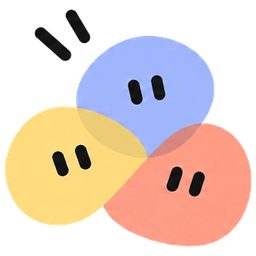

<p align="center"></p>

# oovi

Your own crew of AI bots, open source and running on **your own API key**, with no
subscription. Give each bot a face and a job, put them in groups, and watch
them pass work to each other.

## What you get

- **Bots with faces.** Each bot is a hand-drawn doodle face you design yourself
  (color, hair, eyes, nose, mouth, glasses, hats…). Its expression follows what
  it's doing: thinking, working, waiting for your OK, done, or stuck.
- **Groups where bots talk to each other.** `@mention` a bot to pick who answers;
  nobody mentioned → the group's lead answers. When a bot `@mentions` a teammate
  in its reply, that teammate goes next. A per-message hand-off limit stops
  endless ping-pong.
- **Slime avatars.** Soft, glossy blobs that breathe like jelly, squash and
  stretch with their mood, and squish (cheeks puffing) when you press them.
  Pick body shape, cheeks, and accessories like crowns, bows, flowers, caps,
  cat ears, halos, horns and monocles.
- **Never stuck on one model.** Add backup models; if a model is rate-limited,
  down or can't use tools, oovi switches to the next one automatically and
  shows which model answered. One click sets up **free** Gemini and OpenRouter
  models.
- **Your accounts.** Sign in once (yourself) in oovi's browser window; bots with
  *Use my signed-in accounts* can then publish posts, reply to comments and
  download files for you, asking before every click and keystroke. The AI never
  sees your passwords. Downloads land in `Downloads/oovi` and are never opened.
- **A leader that orchestrates.** Every group has a team leader (the starter
  crew is led by *Oovi*, your personal assistant). The leader plans, delegates
  tasks to teammates with @mentions, gets the turn back automatically when
  they're done, checks their work and gives you one final answer.
- **Learns from repetition (skills).** Skills are step-by-step procedures in the
  standard `SKILL.md` format. When you ask for the same kind of task again and
  again, the bot offers to save it as a skill (you approve); next time the skill
  loads automatically. Install shared skills from a link or GitHub folder.
- **MCP tools.** Connect MCP servers (files, GitHub, Notion, databases…) from the
  official MCP registry, presets, or your own command/URL. Pick which servers
  each bot may use; every MCP call asks you first unless you trust the server.
- **Mix models in one team.** Every bot can use its own provider and model, for
  example Grok for research, Claude for writing and a local Ollama model as the critic.
- **Bring your own key:** Anthropic, OpenAI, xAI, Google Gemini, OpenRouter,
  Ollama, or any OpenAI-compatible server.
- **Real tools, per bot:** web search (SearXNG, Brave or Tavily) and a sandboxed
  browser (open, read, click, type). Turn them on or off for each bot.
- **Live view:** see each bot's browser screen and a feed of recent actions.
- **You stay in charge:** bots ask before typing into pages or clicking buttons,
  and you can stop a run at any time.
- **Keeps working in the background:** switch chats or reload while bots work.
- **Token counts** on every reply, so you can see what you're spending.
- **A real desktop app** (Windows, macOS, Linux). Everything runs on your
  computer: chats are plain JSON in your app-data folder (`%APPDATA%\oovi\data`
  on Windows), keys are encrypted (AES-256-GCM), and the built-in server only
  listens on `127.0.0.1` on a random private port.

## Install

Windows: run `oovi Setup <version>.exe`. macOS: open `oovi-<version>-arm64.dmg`
(Apple silicon) or `oovi-<version>.dmg` (Intel) and drag oovi to Applications.

The installers are built by GitHub Actions (`.github/workflows/build.yml`): open
the repo's **Actions** tab → *Build desktop apps* → *Run workflow*, then download
them from the run's *Artifacts*. They aren't code-signed yet, so on first launch:
Windows → "More info" → "Run anyway"; macOS → right-click oovi → **Open** → Open
(or run `xattr -cr /Applications/oovi.app`). You need
Google Chrome or Microsoft Edge installed for the bots' browser (or Docker, see below).

Open oovi, go to **Settings**, paste an API key and click **Save & test
connection**. Pick a **Web search** provider. A starter group, *Studio* (Scout
the researcher, Quill the writer, Nova the critic), is ready to try.

## Develop

Requirements: Node 20+.

```bash
npm install
npm run dev      # desktop window with hot reload
npm start        # production build in the desktop window
npm run dist     # build the installer into dist/ (Windows: .exe, macOS: .dmg, Linux: .AppImage)
```

The app is Next.js (UI + backend) running inside Electron (`electron/main.cjs`).
In development, data goes to `./data`.

### Docker: sandboxed browser + free search (recommended)

```bash
docker compose up -d
```

Then in Settings set **Browser sandbox → Docker** and **Web search → SearXNG**
(`http://127.0.0.1:8888`).

## How a group works

```
You: "@Scout find X, then ask @Quill to write it up"
  └─ Scout  (web + browser)  searches, reads pages … replies "… @Quill please write this up"
       └─ Quill (no tools)   writes … replies "… @Nova can you check?"
            └─ Nova (web)    reviews and replies
```

- Each bot sees the chat from its own point of view: its own tool calls and
  results, plus everyone else's final messages labelled `[Name]`.
- Runs live in the server (`lib/runner.ts`), not the browser tab, so the UI can
  reconnect at any time.
- Approvals pause the run and save its state; **Allow / Deny** resumes it.

## Project layout

| Path | What |
|---|---|
| `lib/orchestrator.ts` | Who speaks next, each bot's tool loop, hand-offs, approvals |
| `lib/runner.ts` | Background runs + event streaming |
| `lib/llm.ts` | Anthropic + OpenAI-compatible APIs with plain `fetch` |
| `lib/tools.ts`, `lib/browser.ts`, `lib/search.ts` | Tools, isolated browser, search APIs |
| `lib/store.ts` | Bots, chats and screenshots as JSON/JPEG in `data/` |
| `components/Face.tsx` | The doodle faces and their moods |
| `components/ChatView.tsx` | Group chat, live view, mentions, approvals |

## Security model

Bots read web pages, and pages can contain text that tries to give them orders
(prompt injection). oovi defends in layers: page content is labelled as untrusted
data in prompts; typing and button clicks need your approval; only `http(s)` is
allowed and local/private networks are blocked; the API only answers requests
from this machine's own pages (blocks CSRF and DNS rebinding); API keys never
reach the browser UI.

**Known gaps:** in local mode the browser runs on your machine (use Docker for
real isolation); a public domain that *resolves* to a private IP isn't caught;
a link that triggers an action doesn't ask for approval.

## Roadmap

- Scheduled routines (cron + prompt) so bots work while you're away
- Long-term memory per bot
- Agent identities: email inbox, SMS/voice, virtual cards with hard limits
- Approvals inbox and audit log across all chats

## License

Proprietary. Copyright (c) 2026 [COMPANY LEGAL NAME]. All rights reserved. See `LICENSE`.
